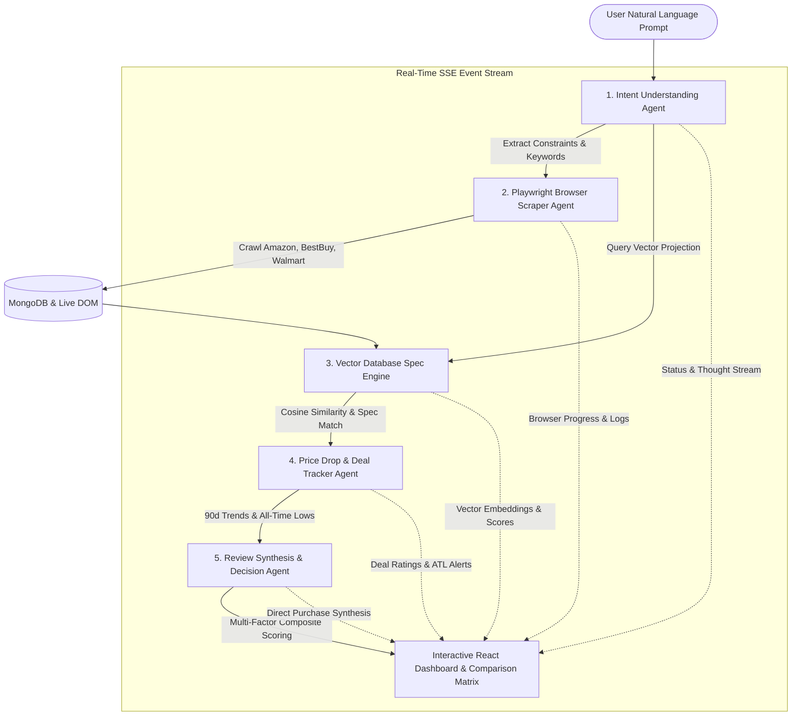

# ⚡ CartNova — Smart AI E-Commerce Shopping Assistant (MERN Stack)

> An advanced **Multi-Agent E-Commerce Shopping Assistant** built on the **MERN Stack** (MongoDB, Express.js, React, Node.js) with **Playwright Browser Automation**, **Vector Database Specification Search**, and **90-Day Price Drop Tracking**.

---

## 🌟 What It Does

1. **Understands Nuanced User Preferences**:
   - Parses complex, unstructured user criteria like:
     - *"Find a lightweight laptop under $1000 with a great battery life for coding"*
     - *"Best noise cancelling wireless headphones under $300 for frequent flying"*
     - *"4K USB-C productivity monitor with portrait mode under $500"*
   - Automatically extracts budget ceilings, hard technical constraints (e.g., minimum 16GB RAM for software development), target weight (< 3.2 lbs), and endurance thresholds (> 12 hours battery).

2. **Navigates Multiple E-Commerce Sites**:
   - Automated multi-store crawling across **Amazon**, **Best Buy**, **Walmart**, and **B&H Photo**.
   - Extracts real-time pricing, instant discounts, stock status, and carrier shipping transit times (e.g., *Free 1-Day Prime*, *Same-Day Store Pickup*).
   - Powered by **Playwright headless Chromium browser automation**.

3. **High-Dimensional Vector Spec Engine**:
   - Indexes deep hardware specifications, architecture details, and verified review sentiment into vector embeddings.
   - Executes **Cosine Similarity** vector searches between user preference vectors and product specification vectors.
   - Computes a granular **Semantic Spec Match % (0 - 100%)** and extracts matching feature pills.

4. **Compiles a Neat Comparison Table**:
   - Spec-by-spec comparison matrix highlighting advantages and trade-offs.
   - Cross-store price comparisons (identifies the lowest price retailer).
   - Synthesizes verified customer reviews into concise **Pros & Cons**.
   - Multi-factor composite decision scoring (40% Semantic Match + 25% Deal Quality + 20% Verified Rating + 15% Shipping Speed).
   - Badges winners (*🏆 Top Recommended Pick*, *⚡ Portability & Battery Pick*, *💰 Best Value Pick*, *🚀 Performance Pick*).

5. **90-Day Price Drop & Deal Tracking**:
   - Analyzes historical pricing curves over 30, 60, and 90-day windows.
   - Detects **All-Time Lows (ATL)** and price drop velocity.
   - Interactive SVG price trend charts with customizable target price alerts.

---

## 🏛️ Multi-Agent Architecture



---

## 🛠️ Technology Stack (MERN)

| Component | Technology | Role |
| :--- | :--- | :--- |
| **Database** | **MongoDB** + Mongoose | Stores structured catalogs, rich technical specs, 90-day price histories, and price alert watchlists |
| **Backend** | **Express.js** + Node.js | REST APIs, Server-Sent Events (SSE) streaming pipeline, multi-agent orchestration |
| **Browser Engine** | **Playwright** (Chromium) | Headless browser automation for multi-store crawling, DOM extraction, and session probing |
| **Vector Engine** | **Natural (TF-IDF & Embeddings)** | Vector space model, n-gram vectorization, high-dimensional cosine similarity |
| **Frontend** | **React** + **Vite** | Modern SPA with Glassmorphism dark mode, live agent flow visualizer, SVG price charts, comparison matrix |
| **Styling** | **Vanilla CSS Design System** | Curated dark mode, HSL accents, glassmorphic cards, smooth animations |

---

## 🚀 Quick Start Guide

### Prerequisites
- [Node.js](https://nodejs.org/) (v18+)
- [MongoDB](https://www.mongodb.com/) (Running locally on `mongodb://127.0.0.1:27017` or MongoDB Atlas URI)

### 1. Install Dependencies
```bash
# Install root orchestration tools
npm install

# Install backend dependencies
cd server
npm install

# Install frontend dependencies
cd ../client
npm install
cd ..
```

### 2. Seed MongoDB Database
Populates MongoDB with the e-commerce product catalog, specifications, and 90-day pricing curves:
```bash
npm run seed
```

### 3. Launch the Application
Run both the Express backend and React Vite client concurrently:
```bash
npm run dev
```

- **React Web App**: [http://localhost:3001](http://localhost:3001) (or `http://localhost:3000`)
- **Express Backend API**: [http://127.0.0.1:4001](http://127.0.0.1:4001)
- **API Health Check**: [http://127.0.0.1:4001/api/health](http://127.0.0.1:4001/api/health)

---

## 📡 API Reference

### 1. Streaming Multi-Agent Search (Server-Sent Events)
```http
GET /api/stream-search?query=Find+a+lightweight+laptop+under+1000+with+a+great+battery+life+for+coding
```
Streams real-time agent execution events (`agent_status`, `agent_thought`, `pipeline_complete`).

### 2. Standard Search
```http
POST /api/search
Content-Type: application/json

{
  "query": "Find a lightweight laptop under $1000 with a great battery life for coding"
}
```

### 3. Price History
```http
GET /api/products/:id/history
```

### 4. Create Price Drop Alert
```http
POST /api/watchlist
Content-Type: application/json

{
  "product_id": "prod_asus_zenbook_14",
  "product_name": "ASUS Zenbook 14 OLED",
  "target_price": 820.00,
  "current_price": 849.99,
  "user_email": "coder@example.com"
}
```

### 5. View Active Watchlist
```http
GET /api/watchlist
```

---

## 📁 Project Structure

```
Smart-Ecommerce/
├── server/                         # Node.js + Express + MongoDB Backend
│   ├── config/
│   │   ├── db.js                   # MongoDB connection with resilient fallback
│   │   └── seed.js                 # Catalog & price history database seeder
│   ├── models/
│   │   ├── Product.js              # Mongoose schema for products & store offers
│   │   ├── PriceHistory.js         # Mongoose schema for 90-day price trends
│   │   └── Watchlist.js            # Mongoose schema for price drop alerts
│   ├── agents/
│   │   ├── intentAgent.js          # Agent 1: Preference & nuance understanding
│   │   ├── browserAgent.js         # Agent 2: Playwright multi-store crawler
│   │   ├── vectorSpecAgent.js      # Agent 3: Vector spec engine & cosine similarity
│   │   ├── priceDropAgent.js       # Agent 4: 90-day price tracking & ATL detection
│   │   ├── recAgent.js             # Agent 5: Review synthesis, pros/cons & scoring
│   │   └── orchestrator.js         # Multi-agent coordinator & SSE streamer
│   ├── routes/
│   │   ├── searchRoutes.js         # Search & SSE streaming routes
│   │   ├── productRoutes.js        # Catalog & price history routes
│   │   └── watchlistRoutes.js      # Price alert watchlist routes
│   └── index.js                    # Express server entry point
│
├── client/                         # React Frontend (Vite)
│   ├── src/
│   │   ├── components/
│   │   │   ├── Navbar.jsx          # Header with agent status & active alerts
│   │   │   ├── HeroSearch.jsx      # Nuanced prompt bar & preset pills
│   │   │   ├── AgentFlow.jsx       # 5-Agent live execution visualizer & console drawer
│   │   │   ├── WinnerCard.jsx      # Top recommended pick banner with direct purchase
│   │   │   ├── ComparisonTable.jsx # Neat spec matrix, cross-store prices, pros & cons
│   │   │   ├── PriceModal.jsx      # 90-Day price history SVG chart & drop tracker
│   │   │   └── Toast.jsx           # Pop-up notifications
│   │   ├── index.css               # Glassmorphism design system & typography
│   │   ├── App.jsx                 # Main application state & SSE handler
│   │   └── main.jsx
│   ├── public/images/              # Photorealistic commercial product renders
│   └── vite.config.js              # Vite config with backend proxy
│
├── package.json                    # Root workspace script runner
└── README.md
```
